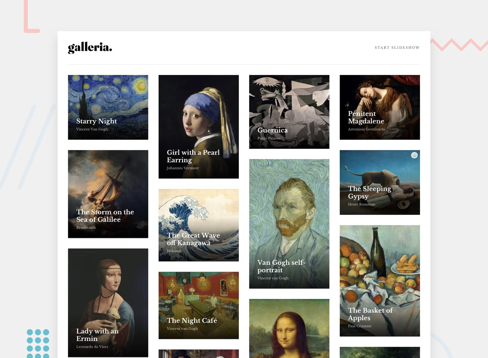
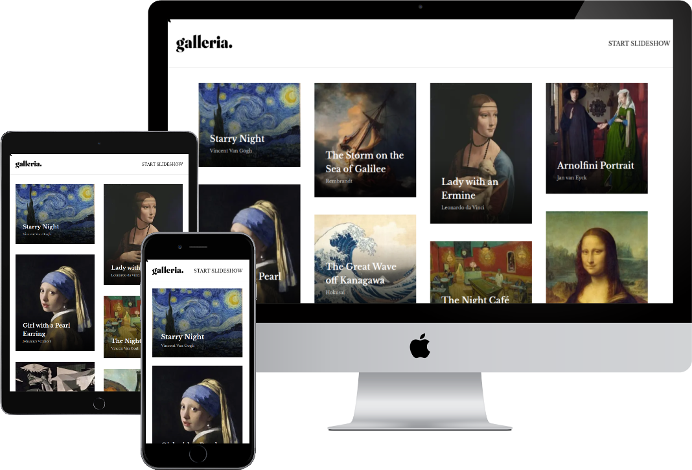
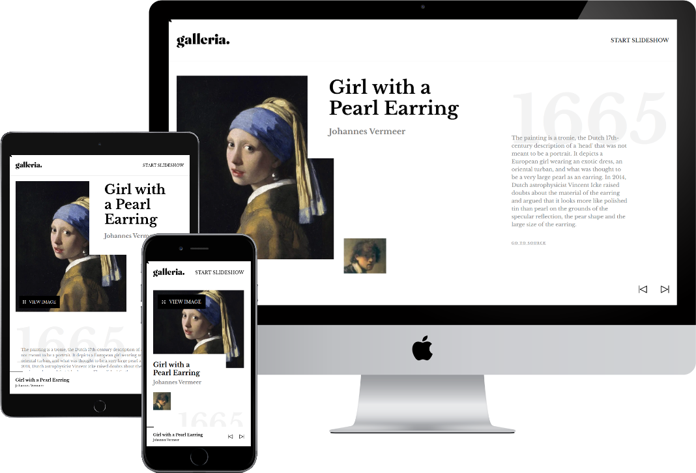

# Frontend Mentor - Galleria Slideshow Site solution

This is my solution to the [Galleria slideshow site challenge on Frontend Mentor](https://www.frontendmentor.io/challenges/galleria-slideshow-site-tEA4pwsa6).
 Frontend Mentor challenges help you improve your coding skills by building realistic projects.


## Table of contents

- [Frontend Mentor - Galleria Slideshow Site solution](#frontend-mentor---galleria-slideshow-site-solution)
  - [Table of contents](#table-of-contents)
  - [Overview](#overview)
    - [The challenge](#the-challenge)
    - [Expected behaviour](#expected-behaviour)
    - [Screenshots](#screenshots)
    - [Links](#links)
  - [My process](#my-process)
    - [Built with](#built-with)
    - [What I learned](#what-i-learned)
    - [Continued development](#continued-development)
    - [Useful resources](#useful-resources)
  - [Author](#author)
  - [Acknowledgments](#acknowledgments)

## Overview

I built an art gallery slideshow site and tried to match the design as closely as I could. The project mixes a masonry layout, slideshow logic and a lightbox, so there was a lot to build.

### The challenge

Users should should be able to:

- See the best layout for the app on my device's screen size
- See hover states for all interactive elements on the page
- Move through the slideshow and view each painting in a lightbox

### Expected behaviour

- On the home page, I see all 15 paintings in a masonry wall. The wall has 1 column on mobile, 2 on tablet and 4 on desktop.
- When I click a painting, I go to its own page with the title, the artist, the year, a short story and a link to the source.
- On a painting page, I can press "View image" to open the picture large in a lightbox. I can close it with the "Close" button or by clicking outside the image.
- At the bottom, the footer shows the current painting and the previous and next buttons.
  - On the first painting, the previous button is disabled.
  - On the last painting, the next button is disabled.
- A progress bar above the footer grows as I move through the paintings.
- Every link and button has a hover state.

### Screenshots

| *Home*| *Artwork (slug)* |
|---|---|
|  | |

### Links

- Solution URL: [Add solution URL here](https://your-solution-url.com)
- Live Site URL: [Add live site URL here](https://your-live-site-url.com)

## My process

### Built with

- Semantic HTML5 markup
- Tailwind CSS v4 with design tokens in `@theme`
- Flexbox
- CSS Grid
- CSS columns for the masonry layout
- Mobile-first workflow
- [React](https://reactjs.org/) - JS library
- [Next.js](https://nextjs.org/) - React framework (App Router)
- [TypeScript](https://www.typescriptlang.org/) - For typed data and props
- [Motion](https://motion.dev/) - For the progress bar animation

### What I learned

In this project I tried a few patterns that I had not used before.

**A compound Dialog.** One Context shares the open state, so the trigger and the window stay separate parts.

```tsx
// State
const DialogContext = createContext<DialogContextValue | null>(null);

export default function Dialog({ children }: { children: ReactNode }) {
  const [isOpen, setIsOpen] = useState(false);
  return (
    <DialogContext.Provider value={{ isOpen, setIsOpen }}>
      {children}
    </DialogContext.Provider>
  );
}

// JSX
<Dialog>
  <DialogTrigger />
  <DialogWindow>{/* big image */}</DialogWindow>
</Dialog>
```

**A portal for the lightbox.** It renders outside the page flow, so no parent can clip it.

```tsx
// Logic
return !isOpen ? null : createPortal(
  <div className="fixed top-0 left-0 z-20 h-screen w-screen">
    {children}
  </div>,
  overlayRoot
);
```

**A small custom hook** to close the lightbox when I click outside of it.

```js
// Logic
export function useClickOutside(ref, callback) {
  const handleClick = (e) => {
    if (ref.current && !ref.current.contains(e.target)) callback();
  };
  useEffect(() => {
    document.addEventListener("click", handleClick);
    return () => document.removeEventListener("click", handleClick);
  });
}
```

**Design tokens in Tailwind v4.** Size, line height and weight live together in one token.

```css
/* Style */
@theme {
  --text-heading-1: 56px;
  --text-heading-1--line-height: 64px;
  --text-heading-1--font-weight: 700;
}
```

**A masonry wall with CSS columns only**, no library.

```tsx
// JSX
<div className="columns-1 sm:columns-2 lg:columns-4 gap-6 sm:gap-10">
  {artworks.map((artwork) => (
    <ArtworkLink key={artwork.slug} className="break-inside-avoid mb-6 sm:mb-10" />
  ))}
</div>
```

**One number drives the navigation.** Previous, next and the progress bar all come from the index of the current slug.

```tsx
// Logic
const index = artworks.findIndex((a) => a.slug === artworkSlug);
const isFirst = index === 0;
const isLast = index === artworks.length - 1;
const progress = (index / (artworks.length - 1)) * 100;
```

**A full-width line inside a narrow container**, with a pseudo-element as wide as the screen.

```tsx
// Style
const containerStyles = cn(
  "sticky top-0 flex justify-between items-center bg-white",
  "before:absolute before:bottom-0 before:h-px before:w-screen before:bg-[#E5E5E5]",
  "before:left-1/2 before:translate-x-[-50vw]"
);
```

### Continued development

- Make the dialog safe for server rendering: read the overlay root after mount, not during render.
- Add keyboard support: close the lightbox with Esc and keep the focus inside it.
- Load only the hero image that the screen needs, and write a real alt text for each painting.
- Add an auto-play mode with play and pause.

### Useful resources

- [Tailwind CSS: Theme variables](https://tailwindcss.com/docs/theme) - Reference for the `@theme` tokens.
- [React: createPortal](https://react.dev/reference/react-dom/createPortal) - Reference for the lightbox portal.
- [Next.js: Dynamic Routes](https://nextjs.org/docs/app/building-your-application/routing/dynamic-routes) - Reference for the `[artworkSlug]` route.

## Author

- GitHub - [@emedranoh19a](https://github.com/emedranoh19a)
- Portfolio repo - [eric-medrano-portfolio](https://github.com/emedranoh19a/eric-medrano-portfolio)
- Frontend Mentor - [@yourusername](https://www.frontendmentor.io/profile/yourusername)

## Acknowledgments

Thanks to [Frontend Mentor](https://www.frontendmentor.io) for the design, the assets and a brief that tests layout, slideshow logic and a lightbox in one project.
